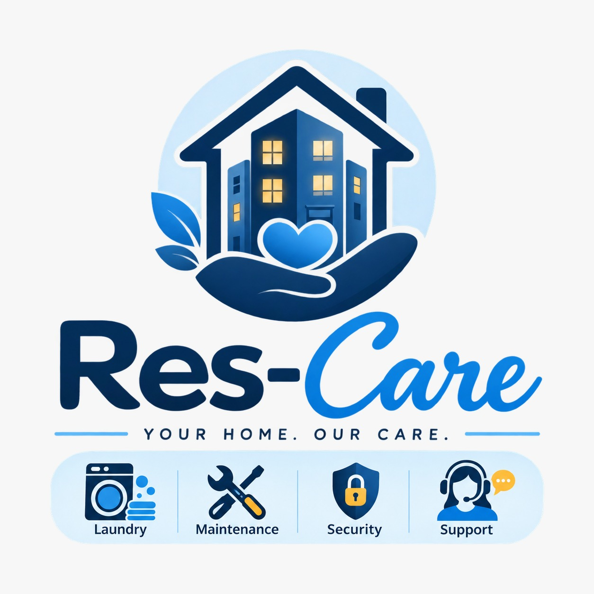
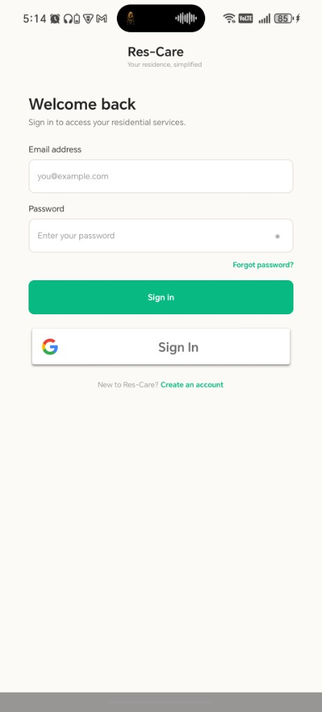
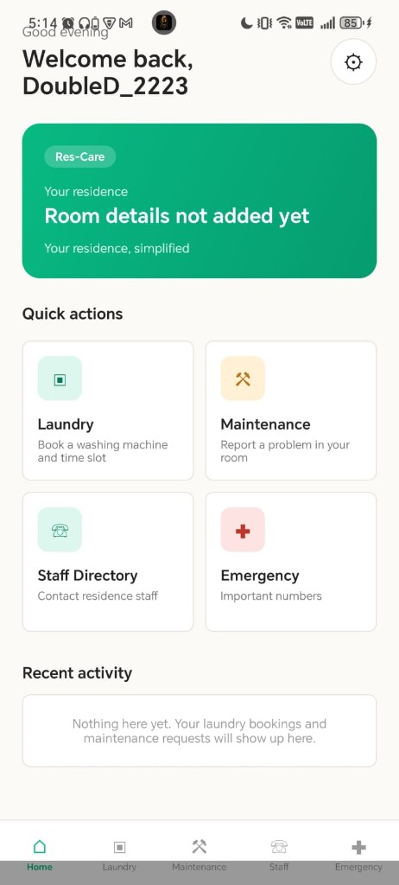
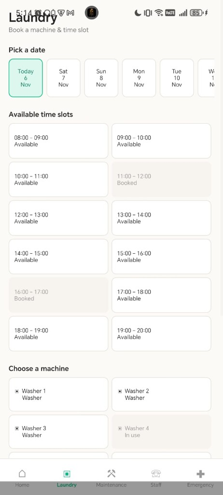
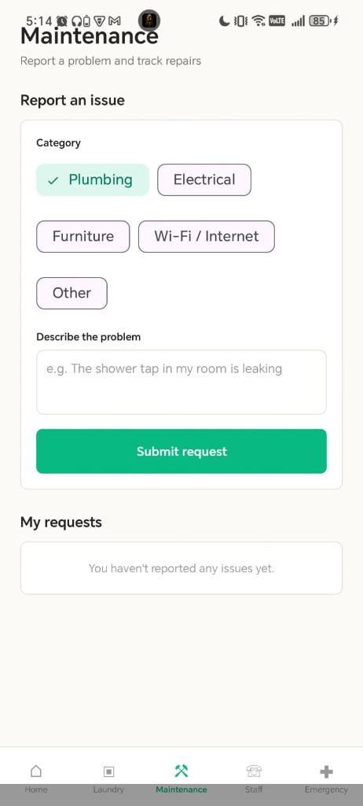
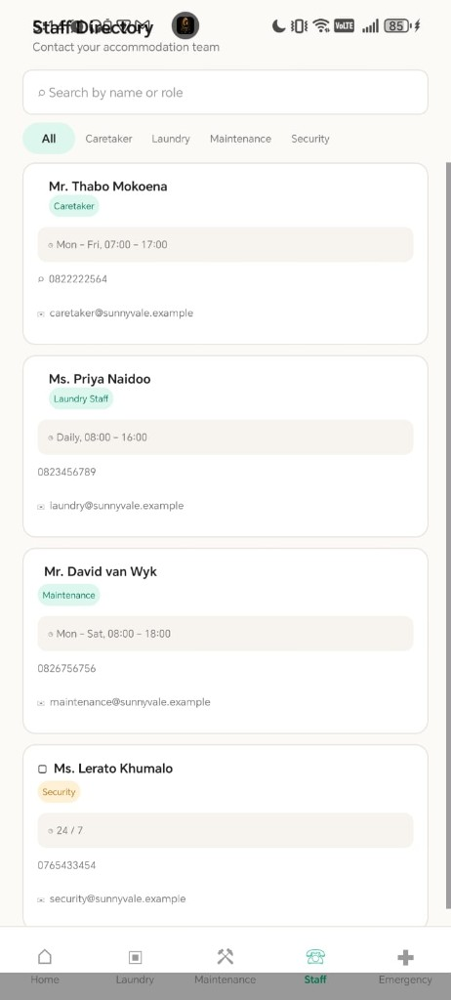
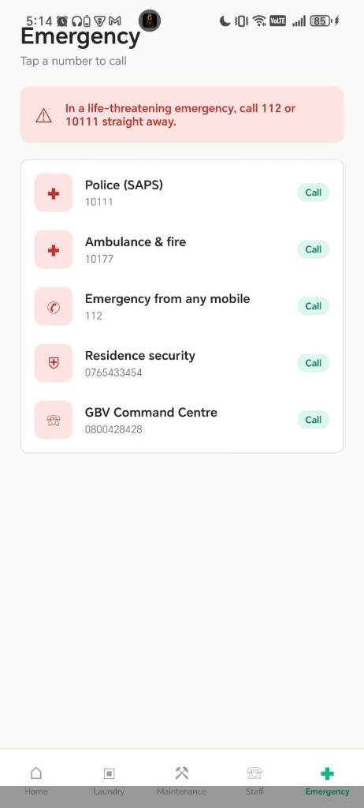
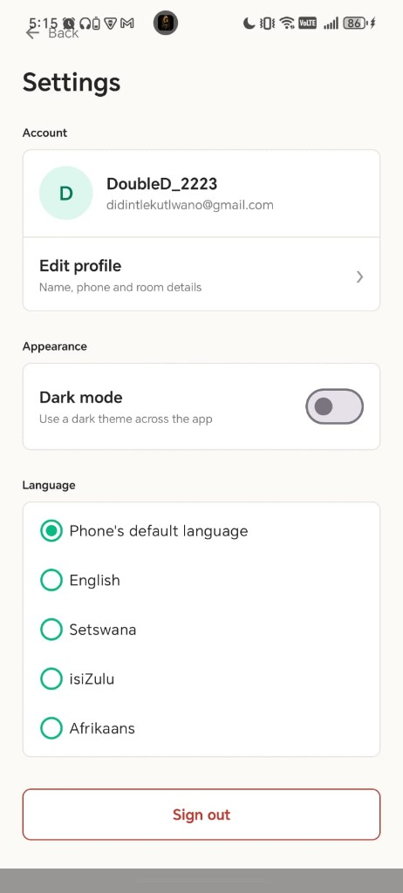
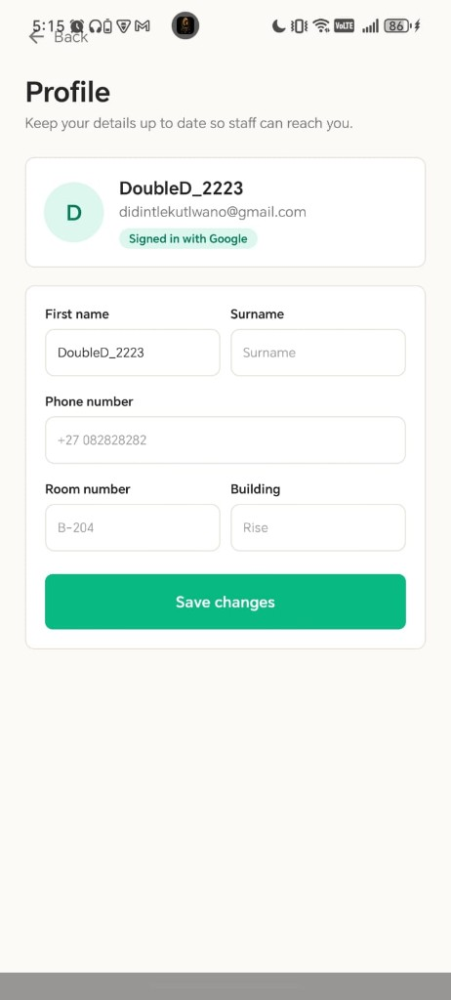

<p align="center">
	
</p>

<h1 align="center">ResCare</h1>

<p align="center"><em>Your residence, simplified.</em></p>

<p align="center">
	<a href="https://github.com/lesedindivhuho/ResCare/releases/latest"><strong>Download the latest APK</strong></a>
</p>

ResCare is an Android application for residents of serviced apartments and student accommodations. It brings everyday residential services into one place instead of relying on notice boards, scattered WhatsApp groups, and word of mouth.

## Contents

- [Purpose](#purpose)
- [Screenshots](#screenshots)
- [Features](#features)
- [Backend: Firebase](#backend-firebase)
- [User Interface](#user-interface)
- [Installing the App](#installing-the-app)
- [Technology](#technology)
- [Project Structure](#project-structure)
- [Getting Started (Developers)](#getting-started-developers)
- [Changelog](#changelog)
- [Collaborators](#collaborators)

## Purpose

Residential service information is often difficult to find and easy to lose. This can lead to double-booked laundry facilities, slow maintenance responses, and residents not knowing who to contact during an emergency.

ResCare provides a single, clear, and accessible platform for residents and accommodation staff.

### Target Users

- **Residents:** The primary users who need to book services, find staff contacts, and access residential information.
- **Accommodation staff:** The secondary users who support laundry, maintenance, security, and resident communication.

## Screenshots

<table>
	<tr>
		<td align="center"><br><b>Login / Register</b></td>
		<td align="center"><br><b>Home dashboard</b></td>
		<td align="center"><br><b>Laundry</b></td>
		<td align="center"><br><b>Maintenance</b></td>
	</tr>
	<tr>
		<td align="center"><br><b>Staff directory</b></td>
		<td align="center"><br><b>Emergency</b></td>
		<td align="center"><br><b>Settings</b></td>
		<td align="center"><br><b>Profile</b></td>
	</tr>
</table>

## Features

| Area | What the resident can do |
| --- | --- |
| Sign in | Create an account with email and password, or sign in with Google. The app remembers the session, so residents stay signed in. |
| Home dashboard | See a time-of-day greeting with their first name, their room and building, quick actions, and their most recent activity. |
| Laundry | Pick a date (today plus the next five days), a time slot, and a machine, then confirm. Bookings are saved to the cloud and listed under "My bookings". |
| Maintenance | Choose a category, describe the problem, and submit a request. Requests are saved to the cloud and listed under "My requests" with their status. |
| Staff directory | View accommodation staff and their roles. |
| Emergency | Tap a contact to open the phone dialler with the number filled in (police, ambulance and fire, the 112 emergency line, residence security, and the GBV helpline). |
| Profile | Edit first name, surname, phone number, room, and building. |
| Settings | Switch between light and dark mode, change the app language, open the profile, and sign out. |
| Languages | English, Setswana, isiZulu, and Afrikaans. |

## Backend: Firebase

ResCare uses [Firebase](https://firebase.google.com/) as its backend. The Firebase project is `rescare-6f516` and the Android package name is `com.example.rescare`. The configuration file `app/google-services.json` connects the app to that project.

### Authentication

Firebase Authentication handles all accounts. Passwords are never stored in the app or in the database.

- **Email and password:** `RegisterActivity` creates the account with `createUserWithEmailAndPassword` (a password needs at least 6 characters). `LoginActivity` signs in with `signInWithEmailAndPassword`.
- **Google sign-in (single sign-on):** `LoginActivity` uses Google Play services sign-in, requesting an ID token with the project's web client ID (`default_web_client_id`, generated from `google-services.json`). The token is exchanged for a Firebase credential with `GoogleAuthProvider.getCredential`. The first time someone signs in with Google, a profile document is created for them from their Google name and email.
- **Staying signed in:** `MainActivity` checks `FirebaseAuth.currentUser` at launch. Signed-in users go straight to the home screen; everyone else sees the login screen.
- **Signing out:** Settings shows a confirmation dialog, then signs out of both Firebase and the Google client (so the account picker appears again next time) and clears the back stack.

Google only accepts sign-ins from apps whose signing certificate is registered in Firebase. The SHA-1 and SHA-256 fingerprints of the release-building machine's debug key are registered in the Firebase console, which is why Google sign-in works in the published APK. A build signed with a different key gets error 10 (`DEVELOPER_ERROR`); see [Option 2](#option-2-build-it-yourself-from-github).

### Cloud Firestore

Each user's data is stored in Cloud Firestore under their own user ID:

```text
users/{uid}                     Profile document
├── firstName, surname, email, phone, room, building
├── provider                    "password" or "google"
├── createdAt                   Server timestamp
│
├── bookings/{bookingId}        Laundry bookings
│   └── date, dateKey, time, machine, createdAt
│
└── maintenance/{requestId}     Maintenance requests
    └── category, description, status ("open"), createdAt
```

- `UserProfile.kt` reads the profile and builds the display name and initials. It falls back to the Google display name if the profile has no first name.
- `UserRecords.kt` adds a record to a user's subcollection, stamping it with a server `createdAt`, and loads the most recent records ordered by `createdAt`.
- The profile screen saves with `SetOptions.merge()`, so editing the profile never overwrites fields it does not show.

### Security Rules

Firestore is locked down so that a signed-in user can only read and write their own documents:

```text
rules_version = '2';
service cloud.firestore {
  match /databases/{database}/documents {
    match /users/{userId}/{document=**} {
      allow read, write: if request.auth != null && request.auth.uid == userId;
    }
  }
}
```

## User Interface

The interface uses Material 3 with a green colour scheme, rounded cards, and XML layouts.

- **Global bottom navigation:** Home, Laundry, Maintenance, Staff, and Emergency are available from every main screen (`BottomNav.kt`, `layout/bottom_nav.xml`). Home is always the root screen. Opening a tab replaces the current tab instead of stacking screens, so the back button always returns to Home.
- **Home dashboard:** A greeting based on the time of day ("Good morning/afternoon/evening") with the resident's first name, plus a residence card with their room and building. Tapping the card opens the profile. Below it are quick-action tiles and a **Recent activity** list that merges the latest laundry bookings and maintenance requests. The dashboard refreshes whenever the resident returns to it.
- **Laundry:** Real calendar dates, localised to the chosen language. The selected date, slot, and machine are highlighted. Confirmed bookings appear immediately under "My bookings".
- **Maintenance:** Category chips (for example plumbing and electrical), a description field, and a list of the resident's requests with a status badge.
- **Emergency:** Red-accented contact cards; tapping one opens the dialler.
- **Settings:** An account card (initials avatar, name, and email), an **Edit profile** button, a dark mode switch, a language picker, and a **Sign out** button.
- **Profile:** Editable fields for name, surname, phone, room, and building, plus a badge showing whether the account uses Google or email sign-in.
- **Dark mode:** Every colour is defined for both day (`values/colors.xml`) and night (`values-night/colors.xml`). The choice is saved and applied at app start by `ResCareApp`.
- **Languages:** All text lives in string resources with translations in `values-tn` (Setswana), `values-zu` (isiZulu), and `values-af` (Afrikaans). The language is changed per app with `AppCompatDelegate.setApplicationLocales`, and `xml/locales_config.xml` also exposes it in Android 13+ system settings.
- **Shared styles:** Repeated UI pieces (navigation items, cards, titles, buttons, time slots, and quick actions) are defined once in `values/styles.xml`.

## Installing the App

There are two ways to get ResCare on an Android phone.

### Option 1: Download the APK from Releases (recommended)

The ready-to-install APK is attached to the latest release on GitHub:

**[Download ResCare from the Releases page](https://github.com/lesedindivhuho/ResCare/releases/latest)**

1. Open the link above on an Android phone and download `ResCare.apk` under **Assets**.
2. Tap the downloaded file to open it.
3. If Android says installs from that app are not allowed (for example from Chrome or Files), tap **Settings**, turn on **Allow from this source**, and go back.
4. Tap **Install**.
5. If Google Play Protect warns that the app is unknown, tap **More details → Install anyway**. This is normal for apps that are not from the Play Store.

Things to know:

- **Google sign-in works** in the released APK, and so do email/password accounts. Accounts and data are saved in the ResCare Firebase project.
- **Updates:** newer versions are published as new releases. Installing a newer APK over the old one keeps your data.

### Option 2: Build it yourself from GitHub

Clone this repository, open it in Android Studio, and run it (see [Getting Started](#getting-started-developers)). You can also build an APK with **Build → Build App Bundle(s) / APK(s) → Build APK(s)**; the file is created at `app/build/outputs/apk/debug/app-debug.apk`.

Things to know:

- **Google sign-in will fail with error 10 on your build.** Android Studio signs every build with that computer's own debug key, and Google only accepts keys that are registered in the ResCare Firebase project. Email/password sign-in still works.
- To use Google sign-in on your own build, send your debug key's SHA-1 fingerprint to the project maintainer so it can be added to Firebase. You can find it in Android Studio under **Gradle → app → Tasks → android → signingReport** (the `SHA1` line under `Variant: debug`).
- An APK you build cannot be installed over the released APK (they are signed with different keys). Uninstall the other version first.

## Technology

- Kotlin and XML layouts
- Android Gradle Plugin 8.7, Gradle 8.11, Kotlin 2.1
- Minimum Android 7.0 (API 24), target Android 15 (API 35)
- AndroidX Core KTX, AppCompat, Activity, and ConstraintLayout
- Material Components (Material 3)
- Firebase Authentication (email/password and Google)
- Cloud Firestore
- Google Play services Auth (Google sign-in)
- Dependency versions managed in `gradle/libs.versions.toml` with the Firebase BoM

## Project Structure

```text
ResCare/
├── assets/
│   ├── ResCare.jpeg                  # Logo used in this README
│   └── screenshots/                  # App screenshots used in this README
├── app/
│   ├── google-services.json          # Firebase project configuration
│   └── src/main/
│       ├── AndroidManifest.xml
│       ├── java/com/example/rescare/
│       │   ├── ResCareApp.kt         # Applies the saved theme at start-up
│       │   ├── MainActivity.kt       # Routes to Home or Login
│       │   ├── LoginActivity.kt      # Email/password and Google sign-in
│       │   ├── RegisterActivity.kt   # Account creation
│       │   ├── HomeActivity.kt       # Dashboard and recent activity
│       │   ├── LaundryActivity.kt    # Laundry booking
│       │   ├── MaintenanceActivity.kt
│       │   ├── StaffDirectoryActivity.kt
│       │   ├── EmergencyActivity.kt
│       │   ├── SettingsActivity.kt   # Theme, language, account, sign out
│       │   ├── ProfileActivity.kt    # Edit profile
│       │   ├── AppSettings.kt        # Dark mode and language preferences
│       │   ├── BottomNav.kt          # Shared bottom navigation
│       │   ├── UserProfile.kt        # Profile helpers
│       │   ├── UserRecords.kt        # Firestore bookings and requests
│       │   └── ActivityRows.kt       # Rows for activity lists
│       └── res/
│           ├── layout/               # Screen layouts and shared parts
│           ├── values/               # English strings, colours, themes, styles
│           ├── values-night/         # Dark mode colours and theme
│           ├── values-tn/            # Setswana
│           ├── values-zu/            # isiZulu
│           ├── values-af/            # Afrikaans
│           ├── drawable/             # Backgrounds, icons, and app logo
│           └── xml/locales_config.xml
├── gradle/libs.versions.toml         # Dependency versions
├── build.gradle.kts
└── settings.gradle.kts
```

## Getting Started (Developers)

1. Clone the repository and open it in Android Studio.
2. Let Android Studio sync the Gradle project (**File → Sync Project with Gradle Files** if the Run button stays grey).
3. Install the Android SDK platform it asks for, if prompted.
4. Select an emulator or connected device and run the `app` configuration.

The app opens on the login screen. Create an account with **Create an account**, or use Google sign-in (see the note on [error 10](#option-2-build-it-yourself-from-github)).

To connect the app to a different Firebase project instead:

1. Create a Firebase project and add an Android app with the package name `com.example.rescare`.
2. Add your debug key's SHA-1 and SHA-256 fingerprints (from `signingReport`).
3. Enable **Email/Password** and **Google** under **Authentication → Sign-in method**.
4. Create a **Cloud Firestore** database and publish the [security rules](#security-rules) above.
5. Download the new `google-services.json` and replace `app/google-services.json`.

## Changelog

### Version 2.0

**Backend**

- Replaced the local `SharedPreferences` accounts with Firebase Authentication (email and password).
- Added Google sign-in with Firebase, including the SHA-1/SHA-256 setup that fixes error 10.
- Added Cloud Firestore for user profiles, laundry bookings, and maintenance requests, with per-user security rules.
- Users stay signed in between launches and can sign out from Settings.

**User interface**

- Redesigned the home screen with a personalised greeting, residence card, quick actions, and recent activity.
- Added a global bottom navigation bar that works on every main screen.
- Added the Maintenance, Emergency, Settings, and Profile screens.
- Laundry now uses real dates, saves bookings, and lists the resident's bookings.
- Added dark mode and translations into Setswana, isiZulu, and Afrikaans.
- Moved all hard-coded text into string resources and repeated UI into shared styles.
- Fixed low-contrast text on the selected laundry date and a duplicate tab in the staff screen.

### Version 1.0

- First prototype: login and registration with local storage, home navigation, laundry slot selection, staff directory, and the ResCare logo.

## Version Control

The project is maintained in Git and hosted on GitHub:

[github.com/lesedindivhuho/ResCare](https://github.com/lesedindivhuho/ResCare)

Git is used for version history, collaboration, code review, documentation, and project transparency.

## Reference

The original application concept and design reference were produced with Readdy:

[Readdy project reference](https://readdy.ai/project/b7775bcd-890a-4863-bc81-13748b490014)

## Collaborators

| Name and surname | Email |
| --- | --- |
| Tiisetso Mokoena | tiisetsomokoena900@gmail.com |
| Thabiso Morebodi | Morebodithabiso@gmail.com |
| Owam  Zililo | St10455219@Rcconnect.edu.za |
| Ndivhuho Nemaungani | nemaunganilesedi@gmail.com |
